# Отчёт по лабораторной работе № 1 «Отказоустойчивый кластер PostgreSQL»

Для выполнения работы нужно развернуть 2 узла PostgreSQL под управлением Patroni, проверить потоковую репликацию WAL и
восстановление доступа к базе данных после остановки основного сервера.

## Стенд

В Compose 5 контейнеров кластера и 1 прокси. На `pg1` и `pg2` работают PostgreSQL 18.7 и Patroni 4.1.5. Patroni
использует etcd 3.7.4 как распределённое хранилище состояния кластера и хранит в нём блокировку лидера. Для
кворума Raft нужны 2/3 участников etcd. Лидер Raft относится к кластеру etcd. Роль `Leader` в Patroni обозначает
узел PostgreSQL, удерживающий блокировку лидера. У каждого экземпляра PostgreSQL и etcd свой том.

С хоста `psql` подключается к `127.0.0.1:15432`. Envoy 1.37.10 работает как TCP-прокси и проверяет оба узла
HTTP-запросом `GET /primary` на порту `8008`. Patroni отвечает `200 OK`, если PostgreSQL работает как основной сервер
(primary) и узел удерживает блокировку лидера. Envoy направляет новые подключения PostgreSQL на `TCP/5432` этого узла.
В этой работе etcd используется вместо ZooKeeper, Envoy — вместо HAProxy.

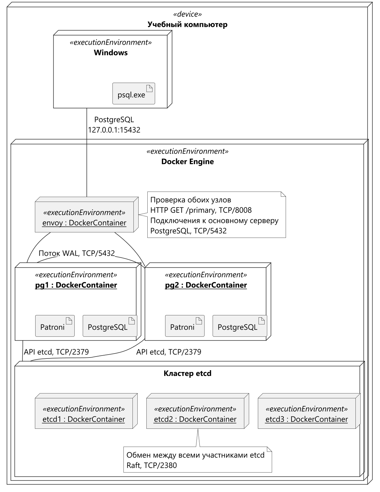

Оба узла Patroni обращаются к клиентским адресам `etcd1:2379`, `etcd2:2379` и `etcd3:2379`. Участники etcd обмениваются
сообщениями Raft на `TCP/2380`. Реплика открывает соединение с основным сервером на `TCP/5432` и получает поток WAL.
[Исходник диаграммы PlantUML](figures/architecture.puml)

Оба узла PostgreSQL собраны из одного [Dockerfile](Dockerfile) на базе `postgres:18.7-trixie`. При старте сначала
запускается Patroni, который управляет процессом PostgreSQL. В [patroni.yml](patroni.yml) указаны адреса etcd и
начальные настройки синхронной репликации. Имена и адреса отдельных узлов задаёт [compose.yaml](compose.yaml). Там же
задана зависимость запуска PostgreSQL от готовности трёх узлов etcd. Проверки Envoy описаны в [envoy.yaml](envoy.yaml).

## Ручная проверка стенда

### Запуск

Нужны Docker с Linux-контейнерами и Docker Compose v2. Для SQL-запросов через опубликованный порт нужен `psql` на хосте.
Перед первым запуском можно задать `LAB1_POSTGRES_PASSWORD` и `LAB1_REPLICATION_PASSWORD` в файле `lab1/.env`.
Команды выполняются из корня репозитория в PowerShell.

```powershell
$labCompose = @('-p', 'comp-net-admin-lab1', '-f', 'lab1/compose.yaml')
docker compose @labCompose config --quiet
docker compose @labCompose up -d --build --wait --wait-timeout 180
docker compose @labCompose ps
```

Точка подключения PostgreSQL через Envoy — `127.0.0.1:15432`. Команда `docker compose @labCompose down` останавливает
стенд и сохраняет именованные тома.

### Состояние контейнеров

```powershell
docker compose @labCompose ps -a --format 'table {{.Service}}\t{{.Status}}' etcd1 etcd2 etcd3 pg1 pg2
```

```text
SERVICE   STATUS
etcd1     Up 8 hours (healthy)
etcd2     Up 8 hours (healthy)
etcd3     Up 8 hours (healthy)
pg1       Up 8 hours (healthy)
pg2       Up 8 hours (healthy)
```

Этот вывод относится к пяти контейнерам PostgreSQL и etcd. В повторном прогоне вместе с Envoy запустились шесть
контейнеров. Полный вывод `docker compose ps` есть в разделе [«Исходные роли»](#исходные-роли).

### Состояние кластера etcd

```powershell
docker compose @labCompose exec -T etcd1 /usr/local/bin/etcdctl --endpoints=http://etcd1:2379 endpoint status --cluster --write-out=table
```

| Узел    | Лидер Raft | Индекс Raft | Применённый индекс Raft | Ошибки |
|---------|------------|------------:|------------------------:|--------|
| `etcd1` | Да         |       11385 |                   11385 | —      |
| `etcd2` | Нет        |       11385 |                   11385 | —      |
| `etcd3` | Нет        |       11385 |                   11385 | —      |

Журнал повторного запуска подтвердил готовность etcd принимать клиентские запросы.

```powershell
docker compose @labCompose logs --timestamps --no-color etcd1 etcd2 etcd3 |
    Select-String 'ready to serve client requests'
```

Фрагмент журнала `etcd1` за 27.11.2026 (UTC).

```text
2026-11-27T16:44:35.988258438Z  ready to serve client requests
```

### Роли PostgreSQL

```powershell
docker compose @labCompose exec -T pg1 patronictl -c /etc/patroni.yml list lab1 | Tee-Object -FilePath patroni-roles.txt
```

```text
+ Cluster: lab1 (7710264607718490144) -----+----+-------------+-----+------------+-----+
| Member | Host | Role         | State     | TL | Receive LSN | Lag | Replay LSN | Lag |
+--------+------+--------------+-----------+----+-------------+-----+------------+-----+
| pg1    | pg1  | Leader       | running   |  2 |             |     |            |     |
| pg2    | pg2  | Sync Standby | streaming |  2 |   0/4000310 |   0 |  0/4000310 |   0 |
+--------+------+--------------+-----------+----+-------------+-----+------------+-----+
```

В таблице `TL` — идентификатор линии времени PostgreSQL (timeline ID). `LSN` (log sequence number) — позиция в WAL.
Столбцы `Receive LSN` и `Replay LSN` показывают позиции получения и применения WAL репликой. `Lag` показывает отставание
в байтах.

### Проверка репликации через SQL

В каталоге `lab1` открыл 2 окна PowerShell. В первом подключился к `pg1` через локальный сокет контейнера. Запрос
`pg_is_in_recovery()` вернул `f`, после чего я вставил контрольную строку.

```powershell
docker compose exec --user postgres pg1 psql -X -U postgres -d postgres
```

```sql
SELECT pg_is_in_recovery();

CREATE SCHEMA IF NOT EXISTS lab_replication;

CREATE TABLE IF NOT EXISTS lab_replication.demo (
    id uuid PRIMARY KEY,
    message text NOT NULL
);

INSERT INTO lab_replication.demo (id, message)
VALUES (gen_random_uuid(), 'manual-replication')
RETURNING id, message;
```

```text
 pg_is_in_recovery
-------------------
 f
(1 row)

CREATE SCHEMA
CREATE TABLE
                  id                  |      message
--------------------------------------+--------------------
 2fa04d68-582c-4cd8-a31d-52590ce56e5d | manual-replication
(1 row)

INSERT 0 1
```

Во втором окне подключился напрямую к `pg2` и запросил строку по UUID из вывода `INSERT`.

```powershell
docker compose exec --user postgres pg2 psql -X -U postgres -d postgres
```

```sql
SELECT pg_is_in_recovery();

SELECT id, message
FROM lab_replication.demo
WHERE id = '2fa04d68-582c-4cd8-a31d-52590ce56e5d';
```

```text
 pg_is_in_recovery
-------------------
 t
(1 row)

                  id                  |      message
--------------------------------------+--------------------
 2fa04d68-582c-4cd8-a31d-52590ce56e5d | manual-replication
(1 row)
```

В том же сеансе попробовал вставить строку на `pg2` и посмотрел код ошибки через `\echo :SQLSTATE`. Для повторной
попытки нужно закрыть прерванную транзакцию командой `ROLLBACK`.

```sql
BEGIN;
INSERT INTO lab_replication.demo (id, message)
VALUES (gen_random_uuid(), 'standby-write');
\echo :SQLSTATE
ROLLBACK;
```

```text
BEGIN
ERROR:  cannot execute INSERT in a read-only transaction
```

PostgreSQL вернул код `25006` (`read_only_sql_transaction`).

### Подключение через Envoy

В журнале повторного запуска видно, что Envoy инициализировал upstream-кластеры и запустил рабочие потоки.

```powershell
docker compose @labCompose logs --timestamps --no-color envoy |
    Select-String 'all clusters initialized|starting workers'
```

```text
2026-11-27T16:44:39.910839545Z  cm init: all clusters initialized
2026-11-27T16:44:39.910844789Z  all dependencies initialized. starting workers
```

После возврата реплики отправил HTTP-запросы к обоим узлам из сети Compose.

```powershell
@'
from http.client import HTTPConnection

for host in ("pg1", "pg2"):
    connection = HTTPConnection(host, 8008, timeout=2)
    connection.request("GET", "/primary")
    print(host, connection.getresponse().status)
    connection.close()
'@ | docker compose @labCompose exec -T pg1 python -
```

```text
pg1 200
pg2 503
```

На `pg1` работал основной сервер, `pg2` был репликой. SQL-запрос через опубликованный порт подтвердил, что Envoy открыл
соединение с основным сервером.

```powershell
psql -X -h 127.0.0.1 -p 15432 -U postgres -d postgres -W `
    -c "SELECT pg_is_in_recovery() AS in_recovery, inet_server_addr() AS server_addr;"
```

```text
 in_recovery | server_addr
-------------+-------------
 f           | 172.23.0.7
(1 строка)
```

Запрос попал на основной сервер (`in_recovery = f`). В этом прогоне его адрес был `172.23.0.7`.

### Переключение после остановки лидера

Перед остановкой `pg1` был лидером, `pg2` — синхронной репликой. Оба узла были на линии времени 2, отставание реплики
было нулевым. Сначала записал контрольную строку через Envoy, затем из каталога `lab1` остановил `pg1`.

```sql
INSERT INTO lab_replication.demo (id, message)
VALUES (gen_random_uuid(), 'before-failover')
RETURNING id, message;
```

```powershell
docker compose stop pg1
docker compose ps -a
docker compose logs --timestamps --no-color pg1 pg2
```

У `pg1` появился статус `Exited (0)`. Envoy, 3 узла etcd и `pg2` продолжили работу. Открыл новое подключение по
прежнему адресу и проверил, что контрольная строка читается, а новая записывается.

```powershell
$beforeFailoverId = 'e5bc216e-6ac4-49c8-a419-8a0fa8730c4e'
psql -X -h 127.0.0.1 -p 15432 -U postgres -d postgres -W `
    -c "SELECT pg_is_in_recovery() AS in_recovery, inet_server_addr() AS server_addr; SELECT id, message FROM lab_replication.demo WHERE id = '$beforeFailoverId';"
```

```powershell
psql -X -h 127.0.0.1 -p 15432 -U postgres -d postgres -W `
    -c "INSERT INTO lab_replication.demo (id, message) VALUES (gen_random_uuid(), 'after-failover') RETURNING id, message;"
```

| Операция через Envoy        | Результат                                                               |
|-----------------------------|-------------------------------------------------------------------------|
| Запись до остановки         | `e5bc216e-6ac4-49c8-a419-8a0fa8730c4e`, `before-failover`, `INSERT 0 1` |
| Проверка нового подключения | `in_recovery = f`, адрес сервера `172.23.0.6` вместо `172.23.0.7`       |
| Чтение после переключения   | `e5bc216e-6ac4-49c8-a419-8a0fa8730c4e`, `before-failover`               |
| Запись после переключения   | `0c5be8e4-122f-4ac6-b8d0-5d0a8643d4aa`, `after-failover`, `INSERT 0 1`  |

В журнале `pg2` видно, когда Patroni занял блокировку лидера и PostgreSQL начал принимать соединения.

```text
2026-11-24 19:01:19,957 INFO: promoted self to leader by acquiring session lock
2026-11-24 19:01:19.974 UTC [41] LOG:  selected new timeline ID: 3
2026-11-24 19:01:20.074 UTC [34] LOG:  database system is ready to accept connections
```

Затем запустил `pg1` командой `docker compose start pg1`. Он возобновил получение WAL на линии времени 3. В
`19:03:46 UTC` Patroni назначил его синхронной репликой. К началу следующей проверки `pg1` получал и применял WAL до
`0/403A518` без отставания, лидером оставался `pg2`.

### Запись без реплики и её чтение после запуска

Перед остановкой `pg1` проверил настройки кластера через `patronictl show-config lab1` на `pg2`. Команда показала
`synchronous_mode: 'on'`, `synchronous_mode_strict: false` и `synchronous_node_count: 1`.

```powershell
docker compose stop pg1
docker compose ps -a
psql -X -h 127.0.0.1 -p 15432 -U postgres -d postgres -W
```

После остановки у `pg1` был статус `Exited (0)`. Через Envoy запрос `SELECT pg_is_in_recovery();` вернул `f`, а
`SHOW synchronous_standby_names;` — пустое значение. При `synchronous_commit = on` и назначенной синхронной реплике
PostgreSQL подтверждает коммит после сброса WAL на устойчивое хранилище основного сервера и реплики. При
`synchronous_mode_strict: false` Patroni может очистить `synchronous_standby_names`, когда синхронная реплика
недоступна. Тогда коммит ждёт только локального сброса WAL. Пока `pg1` был выключен, вставил строку через
Envoy.

```sql
INSERT INTO lab_replication.demo (id, message)
VALUES (gen_random_uuid(), 'written-with-replica-stopped')
RETURNING id, message;
```

```text
                  id                  |           message
--------------------------------------+------------------------------
 4f1ef3f6-23b5-4f66-8ab4-fc30ce9bf437 | written-with-replica-stopped
(1 строка)

INSERT 0 1
```

После запуска `pg1` появился в статусе `Replica / streaming` на линии времени 3. Позиции получения и применения WAL
совпали (`0/403A908`), отставание было нулевым. Подключился к `pg1` напрямую и прочитал строку, записанную во время
остановки.

```powershell
docker compose start pg1
docker compose exec -T pg2 patronictl -c /etc/patroni.yml list lab1
docker compose exec --user postgres pg1 psql -X -U postgres -d postgres
```

```sql
SELECT pg_is_in_recovery();

SELECT id, message
FROM lab_replication.demo
WHERE id = '4f1ef3f6-23b5-4f66-8ab4-fc30ce9bf437';
```

```text
 pg_is_in_recovery
-------------------
 t
(1 row)

                  id                  |           message
--------------------------------------+------------------------------
 4f1ef3f6-23b5-4f66-8ab4-fc30ce9bf437 | written-with-replica-stopped
(1 row)
```

## Замер времени переключения

На графике показан цикл замера, в котором `pg2` был основным сервером, а `pg1` — синхронной репликой. Скрипт
[measure-lab1.py](scripts/measure-lab1.py) отсчитывал время по монотонному таймеру от отправки команды
`docker compose stop pg2`. Для каждой пробы скрипт открывал новое подключение отдельным процессом `psql`. Целевой
интервал между пробами в каждой серии составлял 100 мс. Исходные значения приведены в записи `round: 1`
в [JSON замера](../lab1-measure-20261124-222536-29b53133.json).

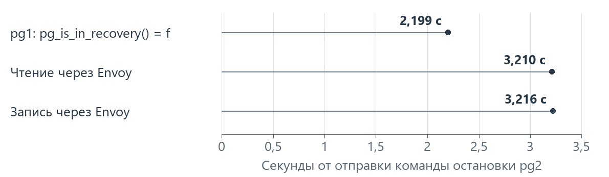

- **2,199 с.** Первый прямой запрос к `pg1` после повышения вернул `pg_is_in_recovery() = f` (false).
- **3,210 с.** Первый успешный `SELECT` контрольной строки через Envoy достиг нового основного сервера `pg1`.
- **3,216 с.** Первый успешный `UPDATE` другой контрольной строки через Envoy выполнился на `pg1`.

Значения отмечают моменты получения успешных ответов. Они включают запуск `psql`, установление соединения и выполнение
запроса.

## Результаты на скриншотах

На скриншотах показан повторный ручной прогон. Исходные роли и UUID относятся к этому прогону. График времени
переключения построен по отдельному автоматизированному замеру. Под каждой иллюстрацией можно открыть оригинальный
скриншот терминала.

### Исходные роли

`docker compose ps` показал шесть запущенных контейнеров. В выводе Patroni `pg2` имел роль `Leader`,
а `pg1` — `Sync Standby`. Оба узла были на линии времени `8`.

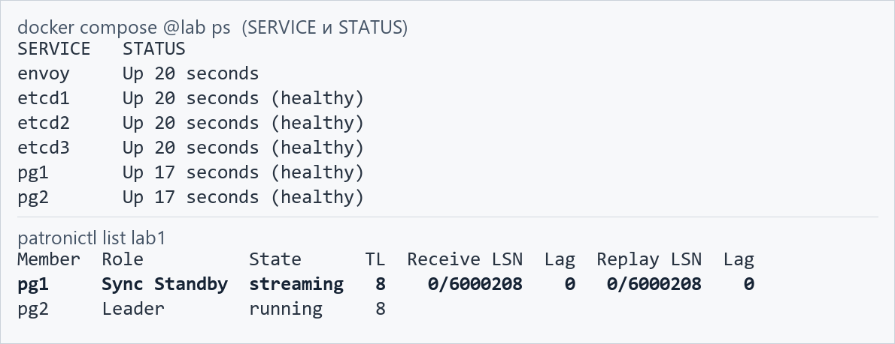

<details>
<summary>Оригинальный скриншот терминала</summary>

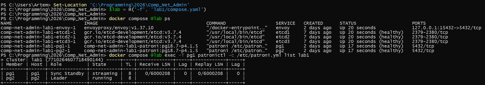

</details>

### Репликация

Создание схемы и таблицы показано в SQL-выводе [первой ручной проверки](#проверка-репликации-через-sql). В повторном
прогоне использовал уже существующую таблицу. Записал `manual-replication` на `pg2` и прочитал её на `pg1`. В обоих
ответах UUID был `3b3b6c9f-27d9-4600-8e79-673a449cb4aa`. При попытке вставки на `pg1` сервер вернул `SQLSTATE 25006`.

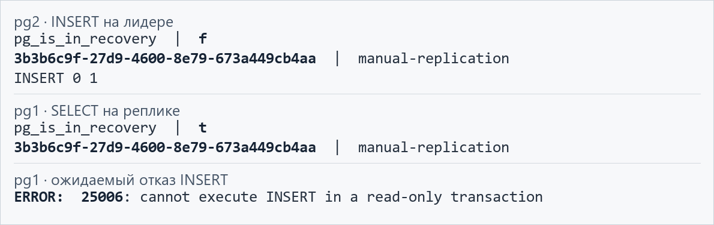

<details>
<summary>Оригинальный скриншот терминала</summary>

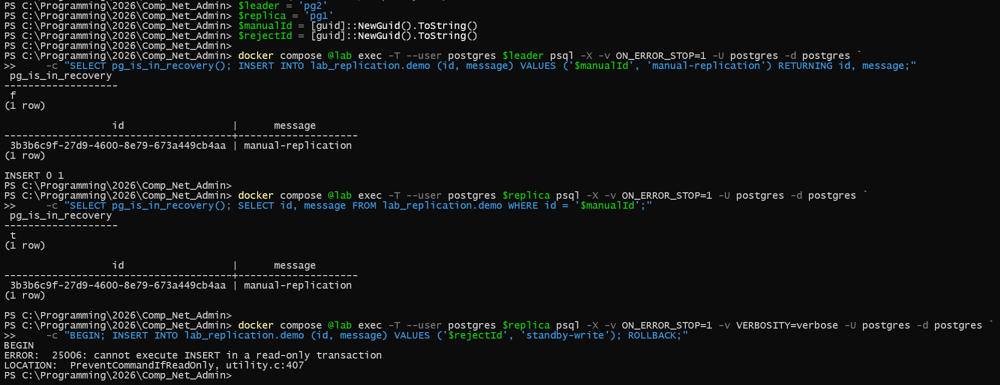

</details>

### Остановка основного сервера

Через Envoy записал строку `before-failover` на `pg2` (`172.23.0.6`). После остановки контейнер `pg2` получил
статус `Exited (0)`, а Patroni показал `pg1` лидером на линии времени `9`.

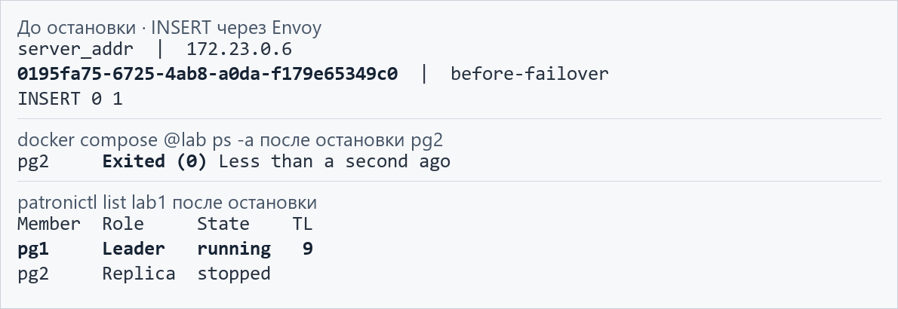

<details>
<summary>Оригинальный скриншот терминала</summary>

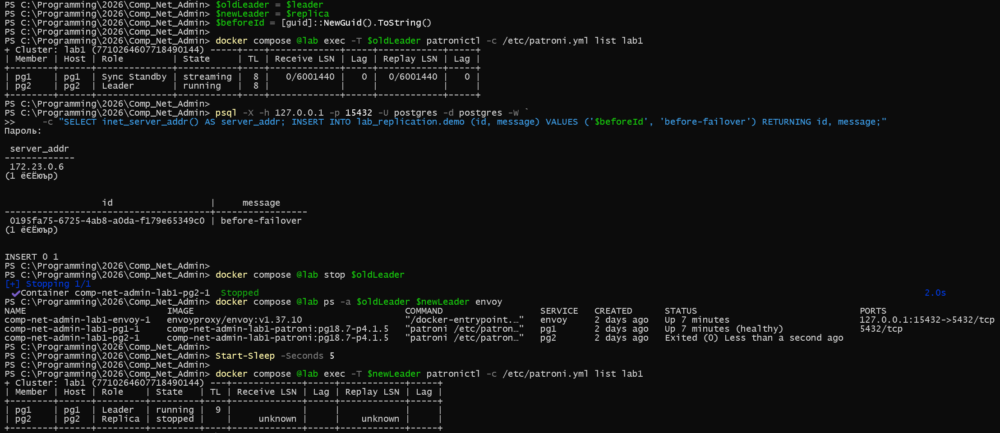

</details>

В журнале того же прогона видно, что Patroni на `pg1` получил блокировку лидера, после чего PostgreSQL выбрал линию
времени `9`.

```powershell
docker compose @labCompose logs --timestamps --no-color --since '2026-11-27T16:51:40Z' pg1 pg2 |
    Select-String 'promoted self to leader|selected new timeline ID'
```

```text
pg1-1 | 2026-11-27T16:51:58.565899118Z  INFO: promoted self to leader by acquiring session lock
pg1-1 | 2026-11-27T16:51:58.578732302Z  LOG:  selected new timeline ID: 9
```

Снова подключился к `127.0.0.1:15432`. Запрос вернул `in_recovery = f` и адрес нового основного сервера `pg1`
(`172.23.0.7`). Через это подключение прочитал `before-failover` с тем же UUID
`0195fa75-6725-4ab8-a0da-f179e65349c0` и вставил `after-failover`.

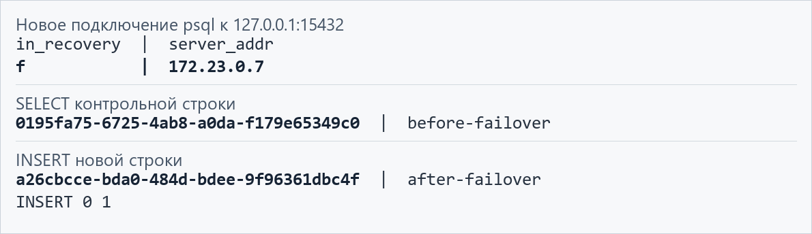

<details>
<summary>Оригинальный скриншот терминала</summary>

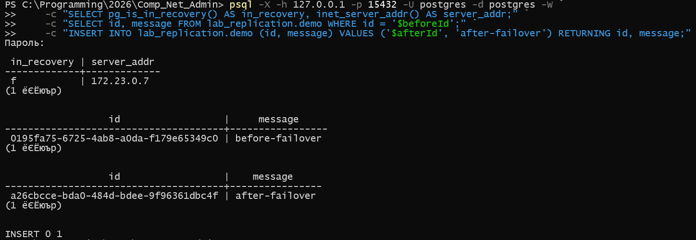

</details>

### Остановка и возврат реплики

Вернул `pg2` в кластер и остановил его уже в роли реплики. Через Envoy проверил, что `synchronous_standby_names`
на основном сервере был пуст, выполнил `INSERT` строки `written-with-replica-stopped` и прочитал её командой `SELECT`.

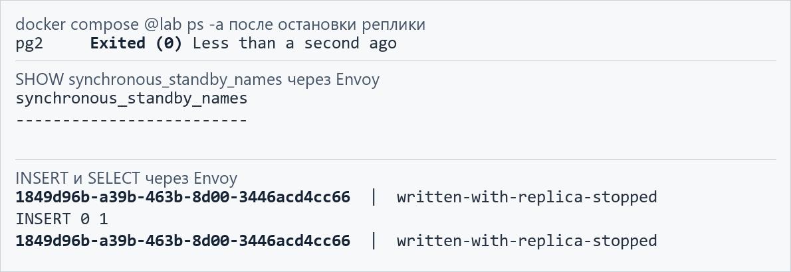

<details>
<summary>Оригинальный скриншот терминала</summary>

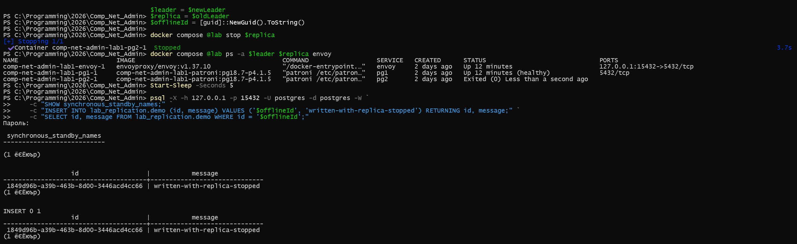

</details>

После запуска `pg2` автоматически возобновил получение и применение WAL. На скриншоте Patroni показывает
`Replica / streaming`, а прямой запрос к `pg2` возвращает `pg_is_in_recovery() = t` и строку с тем же UUID
`1849d96b-a39b-463b-8d00-3446acd4cc66`. Затем Patroni назначил `pg2` синхронной репликой, как видно в журнале.

```powershell
docker compose @labCompose logs --timestamps --no-color --since '2026-11-27T16:58:00Z' pg1 pg2 |
    Select-String 'started streaming WAL|Synchronous standby status assigned'
```

```text
pg2-1 | 2026-11-27T16:58:23.045966549Z  LOG:  started streaming WAL from primary at 0/6000000 on timeline 9
pg1-1 | 2026-11-27T16:58:26.817307275Z  INFO: Synchronous standby status assigned to ['pg2']
```

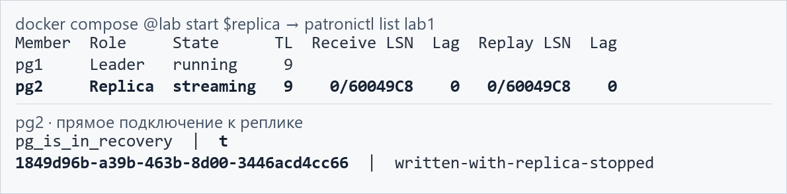

<details>
<summary>Оригинальный скриншот терминала</summary>

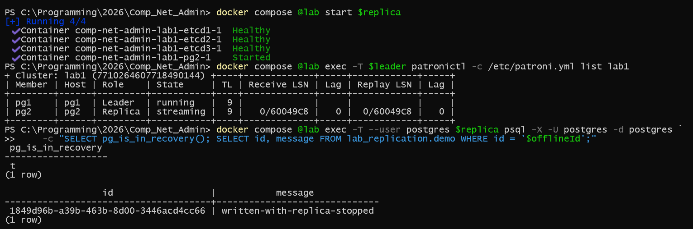

</details>

## Вывод

- **Переключение после остановки лидера.** В ручном прогоне новое подключение к `127.0.0.1:15432` через Envoy прочитало
  контрольную строку на новом основном сервере и выполнило `INSERT`. В цикле, показанном на графике, первый успешный
  `UPDATE` через Envoy завершился через 3,216 с после отправки команды остановки `pg2`.
- **Возврат реплики.** При `synchronous_mode_strict: false` основной сервер подтвердил запись в отсутствие реплики.
  После запуска реплика применила WAL, и контрольная строка стала доступна при прямом чтении с неё.
- **Альтернативный стек.** Patroni управлял ролями PostgreSQL, etcd хранил состояние кластера и блокировку лидера, Envoy
  направлял новые подключения на узел, прошедший проверку `GET /primary`.

## Ответы на вопросы

### Чем отличаются `expose` и `ports`?

`expose` описывает порт внутри контейнера. В общей сети Compose контейнеры могут подключаться к слушающему порту и без
этой записи. `ports` публикует порт на хосте. Запись `127.0.0.1:15432:5432` открывает порт Envoy `5432` на адресе хоста
`127.0.0.1:15432`.

### Пересоберётся ли образ при перезапуске?

`docker compose restart` запускает заново существующие контейнеры. После правки `Dockerfile` или `patroni.yml` нужен
`docker compose up -d --build` из каталога `lab1`. Файл `patroni.yml` копируется в образ при сборке. Для уже созданного
кластера настройки из `bootstrap.dcs` меняются через `patronictl edit-config`.
