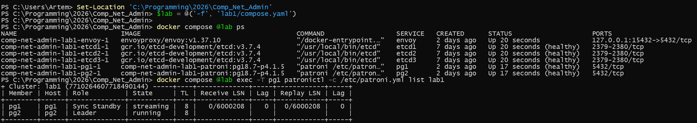
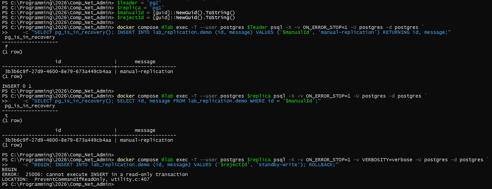
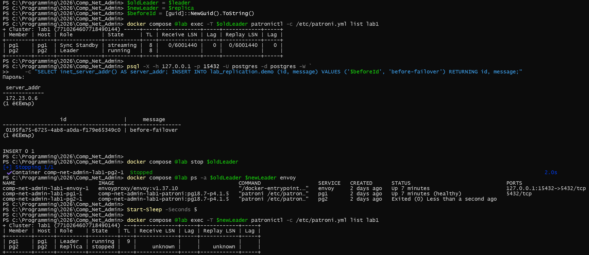
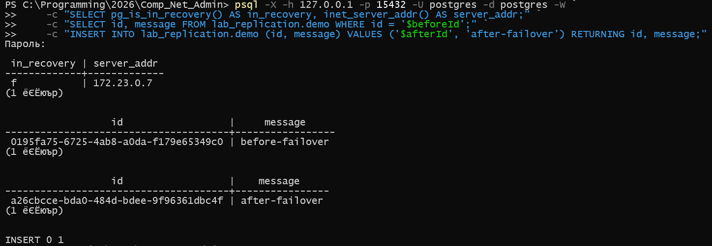
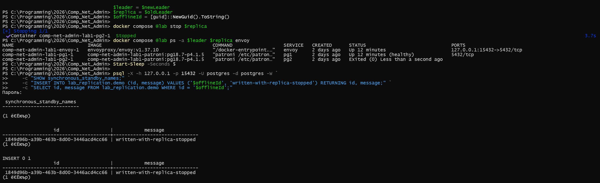
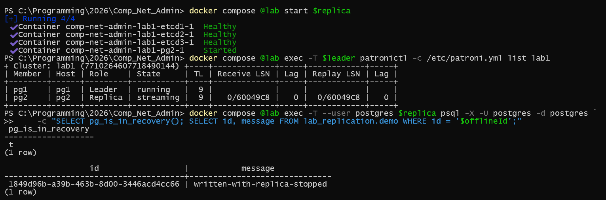

# Отчёт по лабораторной работе № 1 «Отказоустойчивый кластер PostgreSQL»

**Цель** — развернуть кластер PostgreSQL под управлением Patroni, проверить потоковую репликацию, переключение лидера через единую точку входа и получение данных репликой после её возврата.

## Архитектура стенда

| Компонент | Версия | Назначение |
| --- | --- | --- |
| PostgreSQL | 18.7 | Хранит данные и передаёт журнал изменений (WAL) с основного узла на реплику. |
| Patroni | 4.1.5 | Запускает PostgreSQL, следит за его состоянием, настраивает репликацию и управляет ролями узлов. |
| etcd | 3.7.4 | Хранит конфигурацию кластера, сведения об участниках и запись о том, какой узел PostgreSQL имеет право быть основным. |
| Envoy | 1.37.10 | Принимает подключения PostgreSQL на `127.0.0.1:15432` и направляет их на текущий основной узел. |

В Docker Compose развёрнуты два узла PostgreSQL с Patroni (`pg1`, `pg2`), три узла etcd (`etcd1`, `etcd2`, `etcd3`) и Envoy. Все шесть сервисов работают в общей сети Compose. Каждый узел PostgreSQL и etcd использует отдельный именованный том. В варианте стенда etcd заменяет ZooKeeper, а Envoy заменяет HAProxy. Для подтверждения изменений в кластере etcd требуется большинство — два узла из трёх.

## Сборка и конфигурация

Общий образ для `pg1` и `pg2` собран на базе `postgres:18.7-trixie`. [Dockerfile](Dockerfile) устанавливает Patroni с поддержкой etcd и копирует [patroni.yml](patroni.yml) в образ. При старте контейнера Patroni запускается первым и управляет локальным процессом PostgreSQL.

В общей конфигурации Patroni указаны адреса трёх узлов etcd и задан синхронный режим с одной репликой. Имена и сетевые адреса `pg1` и `pg2` передаются отдельно через переменные окружения в [compose.yaml](compose.yaml). Compose запускает узлы PostgreSQL после того, как все три узла etcd прошли проверки готовности.

Envoy проверяет роль каждого узла через `GET /primary` на порту `8008` Patroni. Новые подключения PostgreSQL направляются на порт `5432` узла, прошедшего эту проверку. Параметры прокси заданы в [envoy.yaml](envoy.yaml).

## Ручная проверка стенда от 24 ноября

Команды проверки состояния стенда выполнены из корня репозитория в PowerShell.

```powershell
$labCompose = @('-p', 'comp-net-admin-lab1', '-f', 'lab1/compose.yaml')
docker compose @labCompose ps -a --format 'table {{.Service}}\t{{.Status}}' etcd1 etcd2 etcd3 pg1 pg2
docker compose @labCompose exec -T etcd1 /usr/local/bin/etcdctl --endpoints=http://etcd1:2379 endpoint status --cluster --write-out=table
docker compose @labCompose exec -T pg1 patronictl -c /etc/patroni.yml list lab1 |
    Tee-Object -FilePath patroni-roles.txt
```

### Состояние контейнеров

```text
SERVICE   STATUS
etcd1     Up 8 hours (healthy)
etcd2     Up 8 hours (healthy)
etcd3     Up 8 hours (healthy)
pg1       Up 8 hours (healthy)
pg2       Up 8 hours (healthy)
```

Этот вывод снят при проверке PostgreSQL и etcd. После добавления Envoy запуск через `docker compose up -d --build --wait --wait-timeout 180` завершился успешно. Все шесть контейнеров запустились. Оба узла PostgreSQL и три узла etcd прошли проверки здоровья.

### Состояние кластера etcd

| Узел | Лидер etcd | Индекс Raft | Применённый индекс Raft | Ошибки |
| --- | --- | ---: | ---: | --- |
| `etcd1` | Да | 11385 | 11385 | — |
| `etcd2` | Нет | 11385 | 11385 | — |
| `etcd3` | Нет | 11385 | 11385 | — |

Лидером был `etcd1`. На момент проверки все три участника применили записи журнала до одного и того же индекса.

### Роли PostgreSQL

```text
+ Cluster: lab1 (7710264607718490144) -----+----+-------------+-----+------------+-----+
| Member | Host | Role         | State     | TL | Receive LSN | Lag | Replay LSN | Lag |
+--------+------+--------------+-----------+----+-------------+-----+------------+-----+
| pg1    | pg1  | Leader       | running   |  2 |             |     |            |     |
| pg2    | pg2  | Sync Standby | streaming |  2 |   0/4000310 |   0 |  0/4000310 |   0 |
+--------+------+--------------+-----------+----+-------------+-----+------------+-----+
```

`pg1` работал в роли основного узла PostgreSQL. `pg2` находился в режиме потоковой репликации, а показанное Patroni отставание при получении и применении WAL на момент проверки было нулевым.

### Проверка репликации через SQL

Ручная проверка выполнена из каталога `lab1` в двух окнах PowerShell. На лидере `pg1` открыт сеанс `psql` через локальный сокет контейнера.

```powershell
docker compose exec --user postgres pg1 psql -X -U postgres -d postgres
```

```sql
SELECT pg_is_in_recovery();

CREATE SCHEMA IF NOT EXISTS lab_replication;

CREATE TABLE IF NOT EXISTS lab_replication.demo (
    id uuid PRIMARY KEY,
    message text NOT NULL
);

INSERT INTO lab_replication.demo (id, message)
VALUES (gen_random_uuid(), 'manual-replication')
RETURNING id, message;
```

```text
 pg_is_in_recovery
-------------------
 f
(1 row)

CREATE SCHEMA
CREATE TABLE
                  id                  |      message
--------------------------------------+--------------------
 2fa04d68-582c-4cd8-a31d-52590ce56e5d | manual-replication
(1 row)

INSERT 0 1
```

В отдельном сеансе выполнено подключение напрямую к `pg2` и чтение строки по UUID из результата `INSERT`.

```powershell
docker compose exec --user postgres pg2 psql -X -U postgres -d postgres
```

```sql
SELECT pg_is_in_recovery();

SELECT id, message
FROM lab_replication.demo
WHERE id = '2fa04d68-582c-4cd8-a31d-52590ce56e5d';
```

```text
 pg_is_in_recovery
-------------------
 t
(1 row)

                  id                  |      message
--------------------------------------+--------------------
 2fa04d68-582c-4cd8-a31d-52590ce56e5d | manual-replication
(1 row)
```

В том же сеансе выполнена попытка записи на `pg2`. Код ошибки получен командой `\echo :SQLSTATE`.

```sql
BEGIN;
INSERT INTO lab_replication.demo (id, message)
VALUES (gen_random_uuid(), 'standby-write');
\echo :SQLSTATE
```

```text
BEGIN
ERROR:  cannot execute INSERT in a read-only transaction
```

Реплика вернула ту же строку, которая была записана на лидере. Попытку записи на реплике PostgreSQL отклонил с кодом `25006` (`read_only_sql_transaction`).

### Подключение через Envoy

```powershell
psql -X -h 127.0.0.1 -p 15432 -U postgres -d postgres -W `
    -c "SELECT pg_is_in_recovery() AS in_recovery, inet_server_addr() AS server_addr;"
```

```text
 in_recovery | server_addr
-------------+-------------
 f           | 172.23.0.7
(1 строка)
```

Значение `f` подтверждает, что запрос через Envoy выполнился на основном узле PostgreSQL.

### Переключение после остановки лидера

Команды выполнены из каталога `lab1`. Перед остановкой `pg1` был лидером, а `pg2` — синхронной репликой в состоянии `streaming` с нулевым отставанием. Оба узла работали на линии времени WAL 2. Через Envoy на `127.0.0.1:15432` была записана контрольная строка.

```sql
INSERT INTO lab_replication.demo (id, message)
VALUES (gen_random_uuid(), 'before-failover')
RETURNING id, message;
```

```powershell
$stopStarted = Get-Date
docker compose stop pg1
docker compose ps -a
```

После остановки контейнер `pg1` перешёл в `Exited (0)`. Envoy, все три узла etcd и `pg2` продолжили работу. При новом подключении по тому же адресу Envoy контрольная строка прочиталась, а отдельная команда `INSERT` добавила новую строку с сообщением `after-failover`.

```powershell
$beforeFailoverId = 'e5bc216e-6ac4-49c8-a419-8a0fa8730c4e'
psql -X -h 127.0.0.1 -p 15432 -U postgres -d postgres -W `
    -c "SELECT pg_is_in_recovery() AS in_recovery, inet_server_addr() AS server_addr; SELECT id, message FROM lab_replication.demo WHERE id = '$beforeFailoverId';"
```

```powershell
psql -X -h 127.0.0.1 -p 15432 -U postgres -d postgres -W `
    -c "INSERT INTO lab_replication.demo (id, message) VALUES (gen_random_uuid(), 'after-failover') RETURNING id, message;"
```

| Операция через Envoy | Результат |
| --- | --- |
| Запись до остановки | `e5bc216e-6ac4-49c8-a419-8a0fa8730c4e`, `before-failover`, `INSERT 0 1` |
| Проверка нового подключения | `in_recovery = f`, адрес сервера `172.23.0.6` вместо `172.23.0.7` |
| Чтение после переключения | `e5bc216e-6ac4-49c8-a419-8a0fa8730c4e`, `before-failover` |
| Запись после переключения | `0c5be8e4-122f-4ac6-b8d0-5d0a8643d4aa`, `after-failover`, `INSERT 0 1` |

Журнал PostgreSQL зафиксировал повышение `pg2` и начало приёма соединений.

```text
2026-11-24 19:01:19,957 INFO: promoted self to leader by acquiring session lock
2026-11-24 19:01:19.974 UTC [41] LOG:  selected new timeline ID: 3
2026-11-24 19:01:20.074 UTC [34] LOG:  database system is ready to accept connections
```

Бывший лидер `pg1` запущен командой `docker compose start pg1`. В журналах видно, что он возобновил потоковое получение WAL на линии времени 3. В `19:03:46 UTC` Patroni присвоил ему статус синхронной реплики. Перед следующим опытом `patronictl list` показал `pg2` в роли `Leader`, а `pg1` — в роли `Sync Standby` с нулевым отставанием и позициями получения и применения WAL `0/403A518`.

### Запись при остановленной реплике и получение данных после её возврата

Перед опытом `patronictl show-config lab1`, выполненный в контейнере `pg2`, показал `synchronous_mode: 'on'`, `synchronous_mode_strict: false` и `synchronous_node_count: 1`.

```powershell
docker compose stop pg1
docker compose ps -a
psql -X -h 127.0.0.1 -p 15432 -U postgres -d postgres -W
```

Вывод `docker compose ps -a` показал `Exited (0)` для реплики `pg1`. Лидер `pg2` и Envoy продолжили работу. В сеансе через Envoy запрос `SELECT pg_is_in_recovery();` вернул `f`, а `SHOW synchronous_standby_names;` вернул пустое значение. Пока `pg1` был остановлен, на лидере выполнена вставка.

```sql
INSERT INTO lab_replication.demo (id, message)
VALUES (gen_random_uuid(), 'written-with-replica-stopped')
RETURNING id, message;
```

```text
                  id                  |           message
--------------------------------------+------------------------------
 4f1ef3f6-23b5-4f66-8ab4-fc30ce9bf437 | written-with-replica-stopped
(1 строка)

INSERT 0 1
```

После запуска того же контейнера Patroni показал `pg1` как `Replica / streaming` на линии времени 3. Позиции получения и применения WAL совпали (`0/403A908`), отставание было нулевым. Строка проверена через локальное подключение к `pg1`.

```powershell
docker compose start pg1
docker compose exec -T pg2 patronictl -c /etc/patroni.yml list lab1
docker compose exec --user postgres pg1 psql -X -U postgres -d postgres
```

```sql
SELECT pg_is_in_recovery();

SELECT id, message
FROM lab_replication.demo
WHERE id = '4f1ef3f6-23b5-4f66-8ab4-fc30ce9bf437';
```

```text
 pg_is_in_recovery
-------------------
 t
(1 row)

                  id                  |           message
--------------------------------------+------------------------------
 4f1ef3f6-23b5-4f66-8ab4-fc30ce9bf437 | written-with-replica-stopped
(1 row)
```

## Автоматизированный замер от 24 ноября

В первом цикле автоматизированного замера команда остановки `pg2` была отправлена 24 ноября 2026 года в `22:25:56.778` по московскому времени. Patroni повысил `pg1`, а новые подключения к `127.0.0.1:15432` пошли на `172.23.0.7`. Скрипт `scripts/measure-lab1.py` использовал монотонный таймер. Чтение и запись проверялись независимыми запросами с новым подключением `psql` и целевым интервалом 100 мс.

| Событие | Время от отправки команды остановки `pg2` |
| --- | ---: |
| Первый прямой запрос к `pg1` подтвердил выход из режима восстановления | 2,199 с |
| Первое успешное чтение контрольной строки с `pg1` через Envoy | **3,210 с** |
| Первая подтверждённая запись на `pg1` через Envoy | **3,216 с** |

Между последней успешной проверкой на `pg2` и первой успешной на `pg1` прошло 2,506 с для чтения и 2,478 с для записи. В каждом интервале было 22 неуспешные попытки. Эти интервалы измерены между ответами на запросы и включают запуск `psql`, подключение и выполнение SQL. После отправки команды повторного запуска `pg2` синхронная пара была подтверждена через 5,556 с.

## Повторная демонстрация на скриншотах от 27 ноября

Скриншоты показывают повторение ручных проверок на том же кластере. При повторе исходные роли узлов поменялись, а для контрольных строк использовались новые UUID.

| Что проверили | Ручной прогон 24 ноября | Прогон на скриншотах 27 ноября |
| --- | --- | --- |
| Исходные роли | Лидер `pg1`, синхронная реплика `pg2` | Лидер `pg2`, синхронная реплика `pg1` |
| Смена лидера после остановки | `pg1` → `pg2` | `pg2` → `pg1` |
| Линия времени WAL | 2 → 3 | 8 → 9 |
| Адрес PostgreSQL за Envoy | `172.23.0.7` → `172.23.0.6` | `172.23.0.6` → `172.23.0.7` |
| Реплика, получившая пропущенную запись после запуска | `pg1` | `pg2` |

**Рисунок 1. Запущенный стенд и исходные роли.** Все шесть контейнеров запущены. `pg2` — `Leader / running`, `pg1` — `Sync Standby / streaming` без отставания на линии времени WAL 8.



**Рисунок 2. Ручная проверка репликации.** Строка `manual-replication`, записанная на `pg2`, прочиталась на `pg1` с тем же UUID. Запись на реплике завершилась ошибкой `25006`.



**Рисунок 3. Остановка лидера и повышение реплики.** Строка `before-failover` записана через Envoy на `pg2` (`172.23.0.6`). После остановки `pg2` со статусом `Exited (0)` узел `pg1` стал лидером. Линия времени WAL сменилась с 8 на 9.



**Рисунок 4. Чтение и запись через Envoy после переключения.** Новое подключение к `127.0.0.1:15432` попало на `pg1` (`172.23.0.7`, `in_recovery = f`). Контрольная строка `before-failover` прочиталась с тем же UUID, а вставка `after-failover` вернула `INSERT 0 1`.



**Рисунок 5. Запись при остановленной реплике.** После возврата `pg2` в кластер его остановили уже в роли реплики. Пока контейнер находился в состоянии `Exited (0)`, через Envoy записали и прочитали строку `written-with-replica-stopped` с UUID `1849d96b-a39b-463b-8d00-3446acd4cc66`.



**Рисунок 6. Получение записи после возврата реплики.** После запуска `pg2` Patroni показал `Replica / streaming` с нулевым отставанием. Прямой запрос к `pg2` вернул `pg_is_in_recovery() = t` и строку с тем же UUID, что на рисунке 5.



## Вывод

В обоих ручных прогонах проверена синхронная репликация PostgreSQL и подтверждён отказ записи на реплике с `SQLSTATE 25006`. Patroni переключил лидера с `pg1` на `pg2` 24 ноября и с `pg2` на `pg1` 27 ноября. После каждого переключения через `127.0.0.1:15432` удалось прочитать контрольную строку и записать новую. В обоих прогонах вернувшаяся реплика получила через WAL запись, сделанную во время её остановки. Для координации использовался etcd вместо ZooKeeper, а для маршрутизации подключений — Envoy вместо HAProxy.

## Ответы на вопросы

**Чем отличаются `expose` и `ports`?** `expose` указывает внутренний порт контейнера. В общей сети Compose другие контейнеры могут обращаться к порту, если приложение его слушает, даже без явного `expose`. `ports` публикует порт на хосте. В этом стенде `127.0.0.1:15432:5432` публикует порт Envoy `5432` на локальном адресе хоста и порту `15432`.

**Пересоберётся ли образ при обычном перезапуске?** Команда `docker compose restart` только перезапускает существующие контейнеры. После изменения `Dockerfile` или `patroni.yml` нужно выполнить `docker compose up -d --build` из каталога `lab1`, поскольку файл `patroni.yml` копируется внутрь образа при сборке. Для действующего кластера параметры из `bootstrap.dcs` меняются отдельно через `patronictl edit-config`, поскольку этот блок применяется при первичной инициализации.
