# Отчёт по лабораторной работе №2

**Тема:** Loki + Zabbix + Grafana  
**Цель:** подключить к тестовому сервису Nextcloud мониторинг и логирование, визуализировать их результаты с помощью Grafana.

## 1. Используемые технологии и архитектура

В лабораторной работе развёрнут Docker Compose-стенд из семи сервисов.

| Компонент | Версия | Назначение |
| --- | --- | --- |
| Nextcloud | 29.0.6 | Тестируемое веб-приложение |
| Promtail | 2.9.0 | Сбор и пересылка журнала Nextcloud |
| Loki | 2.9.0 | Приём, хранение и поиск логов |
| Zabbix Server | 6.4 | HTTP-мониторинг Nextcloud и обработка триггеров |
| Zabbix Web | 6.4 | Веб-интерфейс и API Zabbix |
| PostgreSQL | 15 | Хранение конфигурации и данных Zabbix |
| Grafana | 11.2.0 | Визуализация состояния и логов |

**Система логирования.** Nextcloud записывает события в `/var/www/html/data/nextcloud.log`. Общий Docker volume предоставлен Promtail по пути `/opt/nc_data`; Promtail читает файл и отправляет записи по HTTP в Loki. Grafana получает логи из Loki и отображает их в таблице.

**Система мониторинга.** Zabbix Server выполняет HTTP-запросы к `http://nextcloud/status.php`, получает JSON и определяет режим обслуживания Nextcloud. Zabbix сохраняет результаты в PostgreSQL; Grafana через API Zabbix Web отображает их на отдельной панели. Сервисы взаимодействуют по внутренней сети Docker Compose.

## 2. Развёртывание контейнеров

Создан `docker-compose.yml`, задающий семь сервисов, порты, переменные окружения и тома. Команды проверки и запуска:

```powershell
docker compose config --quiet
docker compose up -d
docker compose ps -a
powershell -ExecutionPolicy Bypass -File .\scripts\check-stage1.ps1
```

**Результат.** Синтаксическая проверка Compose прошла без ошибок, все семь контейнеров запустились. PostgreSQL и Zabbix Web получили статус `healthy`. При первоначальном запуске `/ready` Loki временно отвечал HTTP 503, затем возвратил HTTP 200 с телом `ready`. В журнале Loki зафиксировано `Loki started`.

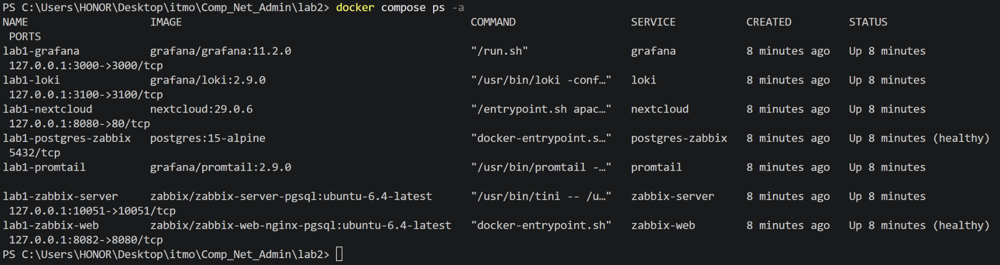

## 3. Инициализация Nextcloud и организация логирования

Через `http://localhost:8080` создан локальный администратор Nextcloud. Команда `php occ config:system:get datadirectory` показала `/var/www/html/data`. Проверено существование файла `nextcloud.log` и наличие в нём реальных JSON-записей.

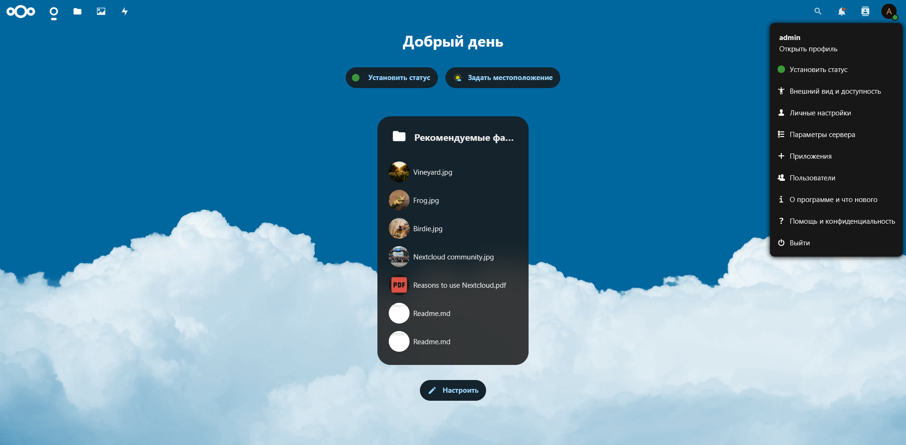

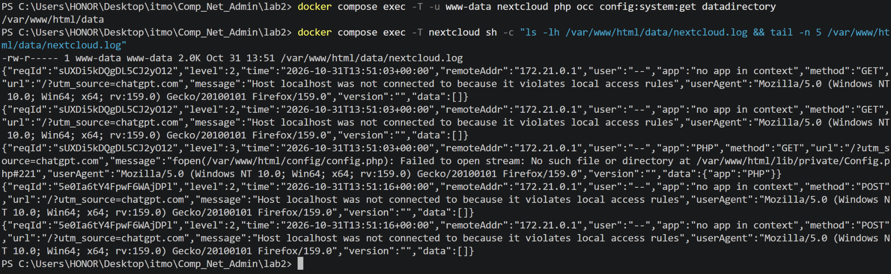

В конфигурации `promtail_config.yml` заданы метка `job=nextcloud_logs`, шаблон файлов `/opt/nc_data/*.log` и адрес Loki `http://loki:3100/loki/api/v1/push`. В логах Promtail наблюдались `Adding target`, `tail routine: started` и `Seeked /opt/nc_data/nextcloud.log`. Скрипт `check-logs.ps1` получил результат `PASS: Nextcloud log exists and Loki returned log streams.`

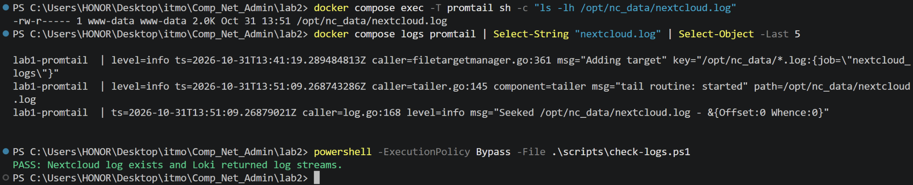

## 4. Настройка мониторинга Zabbix

В Zabbix импортирован шаблон `template.yml`, содержащий элемент `Nextcloud: ping service` (тип HTTP Agent), проверяющий `http://{HOST.HOST}/status.php`. Через JSONPath извлекается `maintenance`, затем выполняется преобразование `false → healthy`, `true → unhealthy`.

Для доступа по имени контейнера Nextcloud добавлен доверенный домен:

```powershell
docker compose exec -T -u www-data nextcloud php occ config:system:set trusted_domains 1 --value=nextcloud
```

Создан хост `nextcloud` с отображаемым именем `Nextcloud Server` и группой `Applications`, привязан импортированный шаблон. В **Monitoring → Latest data** появился элемент `Nextcloud: ping service` со значением `healthy`.

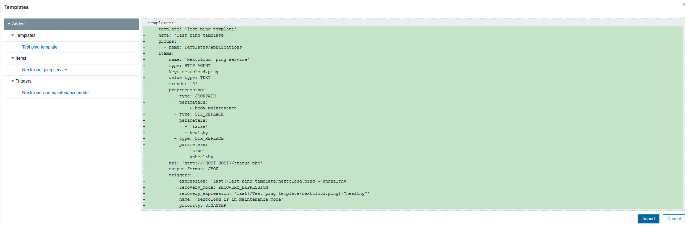

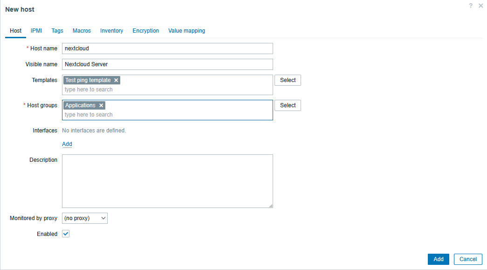


## 5. Имитация аварии и восстановление

Проверена работа триггера `Nextcloud is in maintenance mode`. Режим обслуживания включён командой:

```powershell
docker compose exec -T -u www-data nextcloud php occ maintenance:mode --on
```

После включения `/status.php` вернул `"maintenance":true`. Zabbix отобразил `unhealthy`, а в разделе **Monitoring → Problems** зарегистрировал событие уровня `Disaster` для `Nextcloud Server` в **17:07:31**.

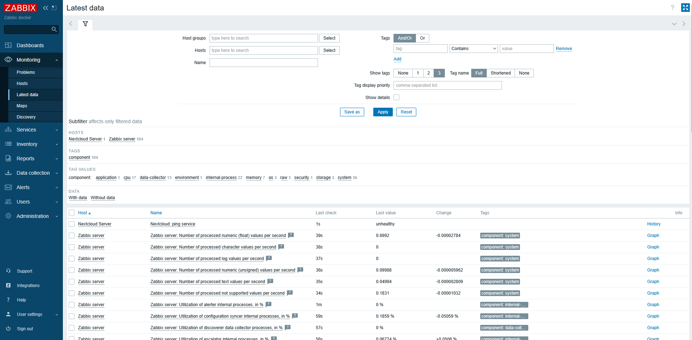

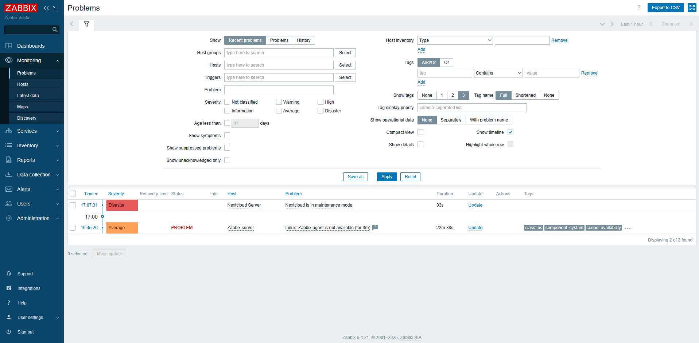

Режим обслуживания отключён:

```powershell
docker compose exec -T -u www-data nextcloud php occ maintenance:mode --off
```

После отключения `/status.php` вернул `"maintenance":false`. Zabbix снова показал `healthy`, а событие получило статус `RESOLVED` в **17:08:31**, то есть через одну минуту. Время приведено по интерфейсу Zabbix.

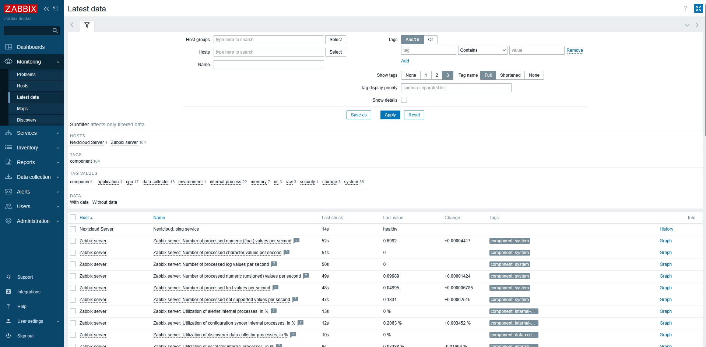

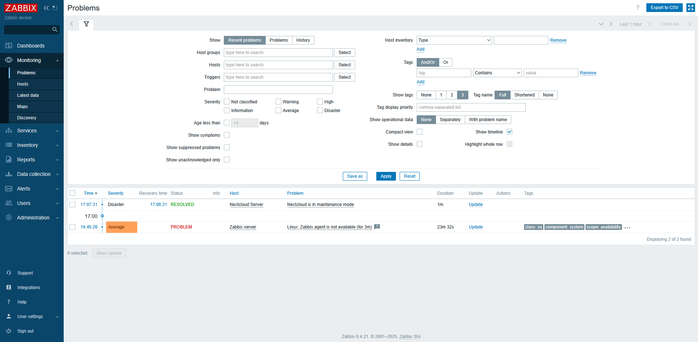

## 6. Интеграция Loki и Zabbix с Grafana

Подключены источники данных `Loki` (`http://loki:3100`) и `Zabbix` (`http://zabbix-web:8080/api_jsonrpc.php`); для Zabbix использован плагин версии 4.5.6. В разделе Explore запрос

```logql
{job="nextcloud_logs"}
```

вернул **5 записей** из первоначального журнала. В Explore для источника Zabbix с типом запроса `Text`, хостом `Nextcloud Server` и элементом `Nextcloud: ping service` получена таблица исторических значений: `healthy` в 17:06:31, `unhealthy` в 17:07:31 и `healthy` в 17:08:31. Примеры дополнительных LogQL-запросов приведены в `QUERIES.md`; их результаты на стенде отдельно не фиксировались.

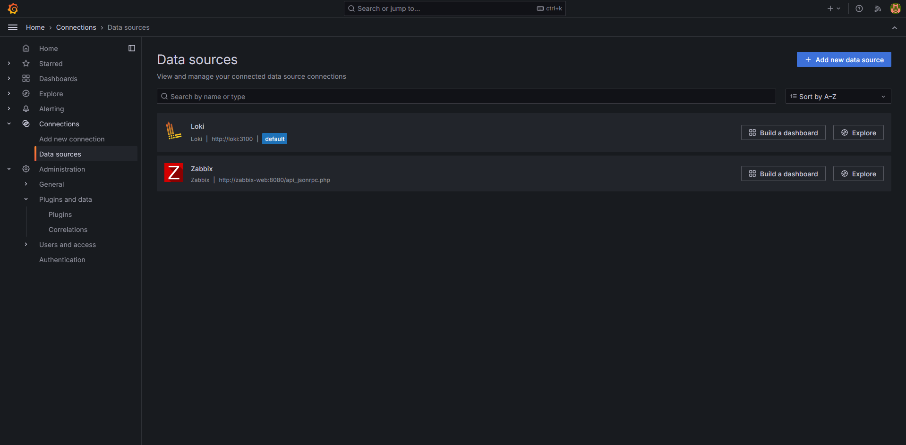

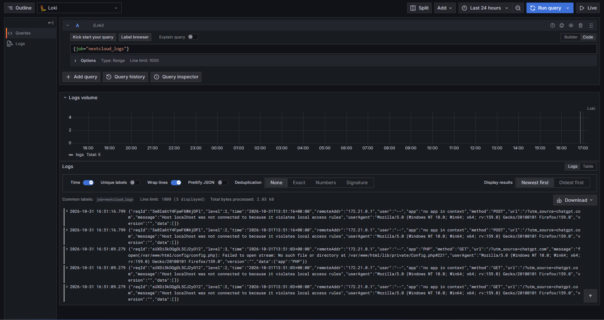

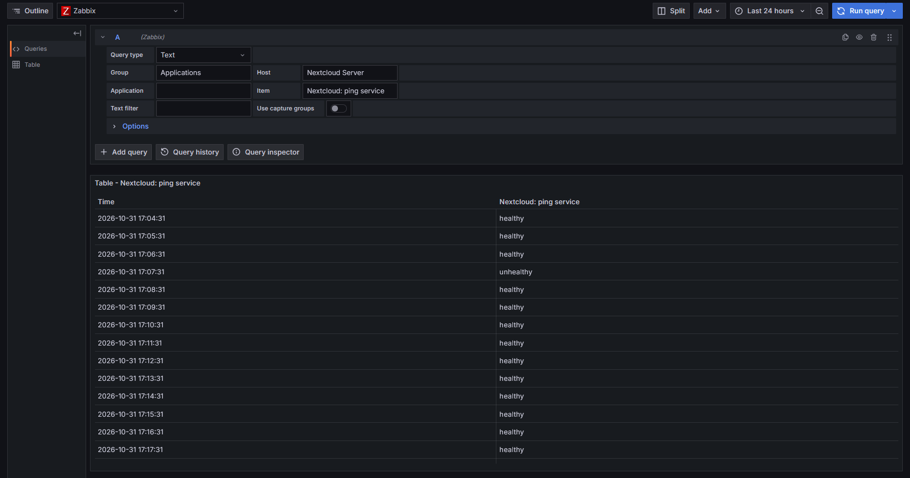

## 7. Два дашборда Grafana

Дашборды хранятся в JSON и автоматически загружаются в папку **Laboratory 2**:

- `lab2-nextcloud-status.json` — цветная панель состояния из Zabbix;
- `lab2-nextcloud-logs.json` — таблица событий Nextcloud из Loki.

Для цветной Stat-панели дополнительно создан **зависимый числовой элемент** `Nextcloud: healthy (numeric)` с ключом `nextcloud.healthy`. Он использует значение исходного текстового элемента: `healthy → 1`, `unhealthy → 0`. Таким образом, исходный триггер и HTTP-проверка не изменены, а Grafana использует обычную числовую метрику. В Zabbix подтверждены одновременно `nextcloud.healthy = 1` и `nextcloud.ping = healthy`.

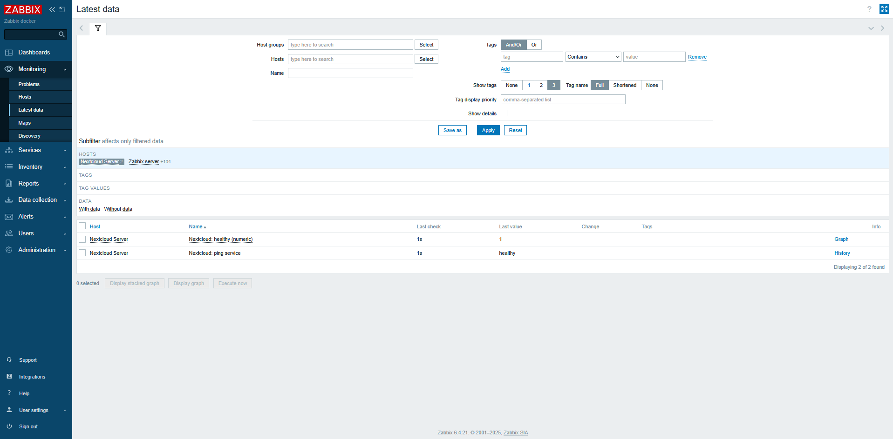

В Grafana открыта панель `Nextcloud — состояние (Zabbix)`, отображающая **HEALTHY** на зелёном фоне.

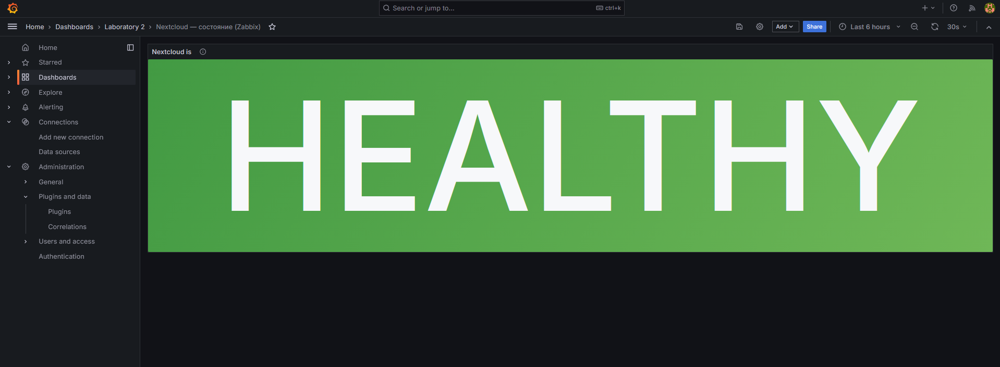

Для таблицы Loki сначала наблюдались 5 записей первоначального журнала. Позже старые записи перестали отображаться в выбранном диапазоне. Для проверки актуальной цепочки данных выполнен `scripts/check-loki-live.ps1`: он добавил одну явно помеченную диагностическую JSON-запись в `nextcloud.log` и нашёл её через HTTP API Loki. Скрипт завершился сообщением:

```text
PASS: Nextcloud file -> Promtail -> Loki. Diagnostic entry: LAB2_PIPELINE_1d7f9a65f7ab
```

В дашборде `Nextcloud — логи (Loki)` с диапазоном **Last 1 hour** появилась запись с тем же идентификатором `LAB2_PIPELINE_1d7f9a65f7ab`. Это подтверждает актуальную передачу события по цепочке Nextcloud → Promtail → Loki → Grafana.

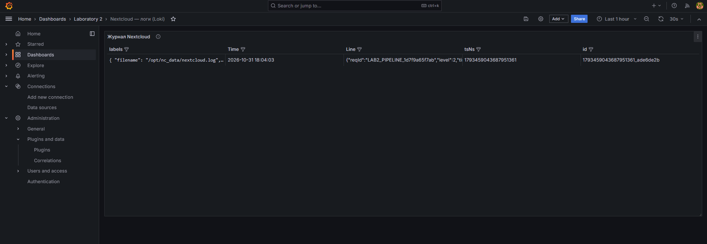

Дополнительный снимок первоначальных пяти записей: [14a-dashboard-logs-initial.png](screenshots/14a-dashboard-logs-initial.png).

**Ограничение стенда:** в исходном Compose-конфиге данные Loki не вынесены в отдельный постоянный volume. Поэтому сохранность истории после пересоздания контейнера Loki не гарантируется. Эта особенность не мешает выполненной проверке текущей передачи логов, но важна при использовании системы вне лабораторной работы.

## 8. Ответы на контрольные вопросы

### 8.1. Чем SLO отличается от SLA?

**SLO (Service Level Objective)** — измеримая цель качества сервиса, например доступность 99,9 % в месяц. **SLA (Service Level Agreement)** — соглашение поставщика и клиента, которое фиксирует обязательства по качеству, способы измерения и возможные последствия невыполнения. SLO задаёт целевой показатель, SLA оформляет обязательства.

### 8.2. Чем инкрементальный бэкап отличается от дифференциального?

**Инкрементальная копия** хранит изменения относительно последнего резервного копирования (полного или инкрементального). Для восстановления обычно требуются полный бэкап и все нужные последующие инкрементальные копии. **Дифференциальная копия** хранит изменения относительно последней полной копии; для восстановления нужны полная копия и последняя дифференциальная. Инкрементальная схема обычно экономит больше места, дифференциальная сокращает число копий, нужных при восстановлении.

### 8.3. В чём разница между мониторингом и observability?

**Мониторинг** следит за заранее выбранными показателями и условиями, обнаруживая известные виды проблем. **Observability (наблюдаемость)** — способность делать выводы о внутреннем состоянии системы по внешним сигналам (метрики, логи, трассировки), в том числе для анализа неизвестных причин сбоев. Мониторинг является частью практик наблюдаемости.

## 9. Вывод

В лабораторной работе №2 развёрнут стенд из семи контейнеров с Nextcloud, Promtail, Loki, Zabbix и Grafana. Проверены создание файловых журналов Nextcloud, их сбор Promtail и получение в Loki; настроен HTTP-мониторинг Zabbix, на примере включения режима обслуживания подтверждены возникновение аварийного события и его последующее закрытие. В Grafana получены данные обоих источников: цветная панель показывает состояние **HEALTHY**, таблица — реальные лог-записи, включая свежую диагностическую запись. Цель работы достигнута.
