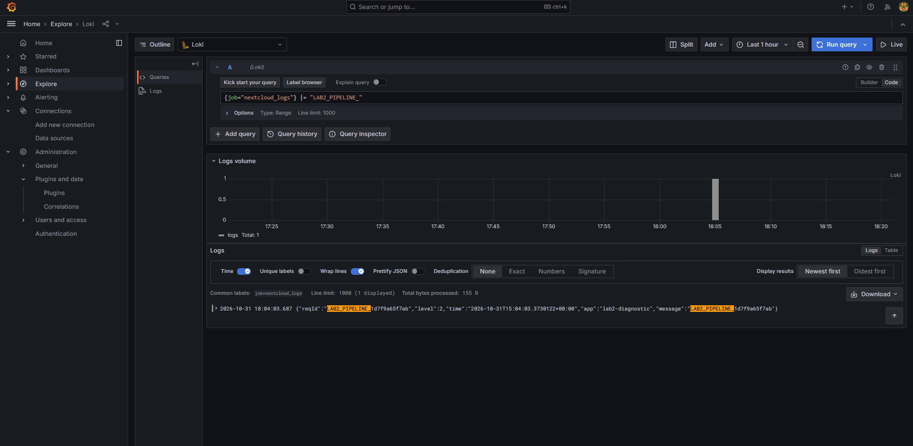

# Отчёт по лабораторной работе №2

**Тема:** Loki + Zabbix + Grafana  
**Цель:** подключить к тестовому сервису Nextcloud мониторинг и логирование, визуализировать их результаты с помощью Grafana.

## 1. Используемые технологии и архитектура

В лабораторной работе развёрнута система из семи сервисов, запускаемых с помощью Docker Compose.

| Компонент | Версия | Назначение |
| --- | --- | --- |
| Nextcloud | 29.0.6 | Тестируемое веб-приложение |
| Promtail | 2.9.0 | Сбор и пересылка журнала Nextcloud |
| Loki | 2.9.0 | Приём, хранение и поиск записей журнала |
| Zabbix Server | 6.4 | Проверка состояния Nextcloud по HTTP и обнаружение проблем |
| Zabbix Web | 6.4 | Веб-интерфейс и программный интерфейс Zabbix |
| PostgreSQL | 15 | Хранение конфигурации и данных Zabbix |
| Grafana | 11.2.0 | Отображение состояния и записей журнала |

**Сбор журналов событий.** Nextcloud записывает события в `/var/www/html/data/nextcloud.log`. Общий том Docker доступен Promtail по пути `/opt/nc_data`; Promtail читает файл и передаёт записи по HTTP в Loki. Grafana получает записи из Loki и отображает их в таблице.

**Система мониторинга.** Сервер Zabbix обращается по HTTP к `http://nextcloud/status.php`, получает ответ в формате JSON и определяет, включён ли режим обслуживания Nextcloud. Результаты сохраняются в PostgreSQL. Grafana получает их через программный интерфейс веб-сервиса Zabbix и отображает на отдельной панели. Сервисы взаимодействуют по внутренней сети Docker Compose.

## 2. Развёртывание контейнеров

Создан `docker-compose.yml`, задающий семь сервисов, порты, переменные окружения и тома. Команды проверки и запуска:

```powershell
docker compose config --quiet
docker compose up -d
docker compose ps -a
powershell -ExecutionPolicy Bypass -File .\scripts\check-stage1.ps1
```

**Результат.** Синтаксическая проверка Compose прошла без ошибок, все семь контейнеров запустились. PostgreSQL и Zabbix Web получили статус `healthy`. При первоначальном запуске `/ready` Loki временно отвечал HTTP 503, затем возвратил HTTP 200 с телом `ready`. В журнале Loki имеется сообщение об успешном запуске (`Loki started`).


## 3. Инициализация Nextcloud и организация логирования

Через `http://localhost:8080` создан локальный администратор Nextcloud. Команда `php occ config:system:get datadirectory` показала `/var/www/html/data`. Проверено существование файла `nextcloud.log` и наличие в нём реальных JSON-записей.


В конфигурации `promtail_config.yml` заданы метка `job=nextcloud_logs`, шаблон файлов `/opt/nc_data/*.log` и адрес Loki `http://loki:3100/loki/api/v1/push`. В служебном журнале Promtail появились сообщения о добавлении источника (`Adding target`), запуске чтения файла (`tail routine: started`) и установке позиции чтения (`Seeked /opt/nc_data/nextcloud.log`). Сценарий `check-logs.ps1` подтвердил, что файл существует и Loki возвращает записи журнала.


## 4. Настройка мониторинга Zabbix

В Zabbix импортирован шаблон `template.yml`, содержащий показатель `Nextcloud: ping service` с проверкой по HTTP по адресу `http://{HOST.HOST}/status.php`. Через JSONPath извлекается `maintenance`, затем выполняется преобразование `false → healthy`, `true → unhealthy`.

Для доступа по имени контейнера Nextcloud добавлен доверенный домен:

```powershell
docker compose exec -T -u www-data nextcloud php occ config:system:set trusted_domains 1 --value=nextcloud
```

Создан хост `nextcloud` с отображаемым именем `Nextcloud Server` и группой `Applications`, привязан импортированный шаблон. На странице последних данных в разделе мониторинга (`Monitoring → Latest data`) появился показатель `Nextcloud: ping service` со значением `healthy`.


## 5. Имитация аварии и восстановление

Проверена работа триггера `Nextcloud is in maintenance mode`. Режим обслуживания включён командой:

```powershell
docker compose exec -T -u www-data nextcloud php occ maintenance:mode --on
```

После включения `/status.php` вернул `"maintenance":true`. Zabbix отобразил `unhealthy`, а на странице проблем мониторинга (`Monitoring → Problems`) зарегистрировал событие наивысшего уровня серьёзности (`Disaster`) для `Nextcloud Server` в **17:07:31**.


Режим обслуживания отключён:

```powershell
docker compose exec -T -u www-data nextcloud php occ maintenance:mode --off
```

После отключения `/status.php` вернул `"maintenance":false`. Zabbix снова показал `healthy`, а событие было отмечено как устранённое (`RESOLVED`) в **17:08:31**, то есть через одну минуту. Время приведено по интерфейсу Zabbix.


## 6. Интеграция Loki и Zabbix с Grafana

Подключены источники данных `Loki` (`http://loki:3100`) и `Zabbix` (`http://zabbix-web:8080/api_jsonrpc.php`); для Zabbix использован плагин версии 4.5.6. В разделе выполнения запросов Grafana (`Explore`) выражение

```logql
{job="nextcloud_logs"}
```

вернул **5 записей** из первоначального журнала. В том же разделе для Zabbix был выбран запрос текстовых значений (`Text`), узел `Nextcloud Server` и показатель `Nextcloud: ping service`. В результате получена таблица исторических значений: `healthy` в 17:06:31, `unhealthy` в 17:07:31 и `healthy` в 17:08:31. Дополнительно проверена фильтрация записей по подстроке средствами LogQL. Запрос `{job="nextcloud_logs"} |= "LAB2_PIPELINE_"` вернул одну диагностическую запись с идентификатором `LAB2_PIPELINE_1d7f9a65f7ab`. Это подтверждает не только выбор потока по метке `job`, но и работу фильтра содержимого строк `|=`. Дополнительные запросы приведены в `QUERIES.md` для самостоятельной проверки; результаты этих примеров в отчёте не представлены.




## 7. Две информационные панели Grafana

Описание информационных панелей хранится в файлах JSON. При запуске Grafana они автоматически загружаются в папку `Laboratory 2`:

- `lab2-nextcloud-status.json` — цветная панель состояния из Zabbix;
- `lab2-nextcloud-logs.json` — таблица событий Nextcloud из Loki.

Для цветного индикатора состояния дополнительно создан **зависимый числовой показатель** `Nextcloud: healthy (numeric)` с ключом `nextcloud.healthy`. Он использует значение исходного текстового элемента: `healthy → 1`, `unhealthy → 0`. Таким образом, исходный триггер и HTTP-проверка не изменены, а Grafana использует обычную числовую метрику. В Zabbix подтверждены одновременно `nextcloud.healthy = 1` и `nextcloud.ping = healthy`.


В Grafana открыта панель `Nextcloud — состояние (Zabbix)`, показывающая нормальное состояние сервиса на зелёном фоне (значение `HEALTHY` в проверенном интерфейсе).


В таблице Loki первоначально отображались пять записей журнала. Позднее они перестали попадать в выбранный временной диапазон. Чтобы подтвердить поступление новых событий, выполнен сценарий `scripts/check-loki-live.ps1`. Он добавил в `nextcloud.log` диагностическую запись в формате JSON и обнаружил её через программный интерфейс Loki. Проверка завершилась успешно; идентификатор записи — `LAB2_PIPELINE_1d7f9a65f7ab`.

В информационной панели `Nextcloud — логи (Loki)` при выборе периода за последний час появилась запись с тем же идентификатором `LAB2_PIPELINE_1d7f9a65f7ab`. Это подтверждает актуальную передачу события по цепочке Nextcloud → Promtail → Loki → Grafana.


Дополнительный снимок первоначальных пяти записей: [14a-dashboard-logs-initial.png](screenshots/14a-dashboard-logs-initial.png).

**Ограничение стенда:** в конфигурации Docker Compose для Loki не предусмотрен отдельный постоянный том. Поэтому сохранность истории после пересоздания контейнера Loki не гарантируется. Эта особенность не мешает выполненной проверке текущей передачи логов, но важна при использовании системы вне лабораторной работы.

## 8. Ответы на контрольные вопросы

### 8.1. Чем SLO отличается от SLA?

**SLO** — целевой показатель уровня обслуживания, например доступность сервиса 99,9 % времени за месяц. **SLA** — соглашение об уровне обслуживания между поставщиком услуги и клиентом. Оно закрепляет требования к качеству, порядок измерения показателей и возможные последствия нарушения обязательств. Таким образом, SLO устанавливает целевое значение, а SLA определяет договорные обязательства.

### 8.2. Чем инкрементальное резервное копирование отличается от дифференциального?

**Инкрементальная копия** хранит изменения относительно последнего резервного копирования (полного или инкрементального). Для восстановления обычно требуются полная резервная копия и все необходимые последующие инкрементальные копии. **Дифференциальная копия** хранит изменения относительно последней полной копии; для восстановления нужны полная копия и последняя дифференциальная. Инкрементальная схема обычно экономит больше места, дифференциальная сокращает число копий, нужных при восстановлении.

### 8.3. В чём разница между мониторингом и наблюдаемостью?

**Мониторинг** следит за заранее выбранными показателями и условиями, обнаруживая известные виды проблем. **Наблюдаемость** — способность судить о внутреннем состоянии системы по внешним данным: показателям работы, журналам событий и трассировкам запросов. Она помогает исследовать в том числе заранее неизвестные причины неполадок. Мониторинг является частью практик наблюдаемости.

## 9. Вывод

В лабораторной работе №2 развёрнут стенд из семи контейнеров с Nextcloud, Promtail, Loki, Zabbix и Grafana. Проверены создание файловых журналов Nextcloud, их сбор Promtail и получение в Loki; настроен HTTP-мониторинг Zabbix, на примере включения режима обслуживания подтверждены возникновение аварийного события и его последующее закрытие. В Grafana получены данные обоих источников: цветной индикатор показывает нормальное состояние Nextcloud, а таблица содержит реальные записи журнала, в том числе последнюю диагностическую запись. Цель работы достигнута.
